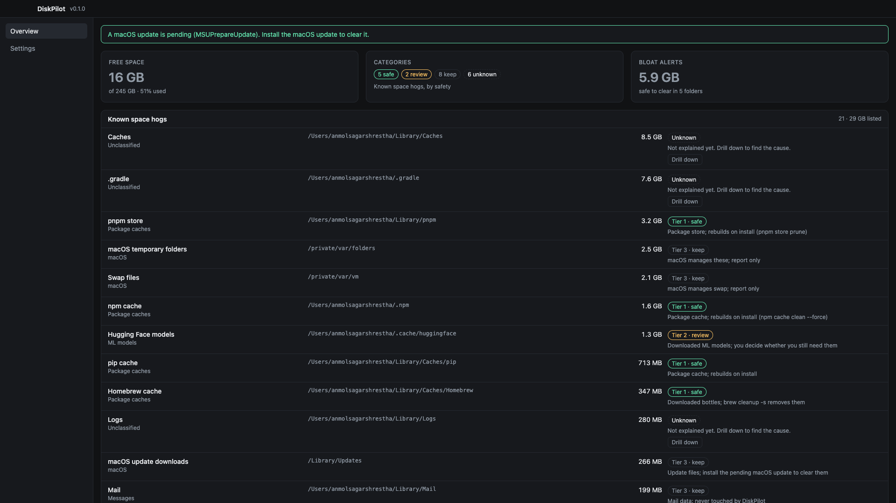

# DiskPilot

An app that shows what's filling your Mac's System Data and helps you safely delete what you don't need.



## How it works

```
Run the audit script → audit.txt → Dashboard shows it → for each item:
   What is it?  Where is it?  How big?  Safe to delete?
      unclear → drill down (look inside, ask again)
      safe    → Claude writes the command → you click Run → moved to Trash
      not safe → keep it
Repeat until only what you need is left.
```

Every item answers four questions: **what** it is, **where** it lives (full path), **how much** space it takes (exact bytes), and **is it safe to delete** (tier 1 safe / tier 2 review / tier 3 keep, with a reason). A big folder is a question, not an answer: the app drills down until the cause is clear.

The app combines three things in one window:

1. **Storage dashboard**: the latest audit, shown visually.
2. **Claude chat**: explains what's using space and proposes cleanups from the audit data.
3. **Terminal**: a real shell that you and Claude share. Claude's commands show up here too.

## Why

My MacBook Air's System Data had grown to 80 GB with 15 GB free. A manual cleanup recovered about 41.7 GB, mostly from stale VS Code extension versions, package caches and app caches. This app automates the steps that worked: audit, classify, drill down, dry-run, and move to Trash. The full reasoning is in [`docs/DECISIONS.md`](docs/DECISIONS.md).

## Safety rules

- **Delete = move to Trash**, never `rm`. Every cleanup can be undone.
- **You approve every deletion.** Claude can't approve its own plan.
- **Allowlist only.** Paths outside the cleanup rules are rejected in code.
- **Never touched:** `/System`, `/Library`, `/private`, `/usr`, system snapshots, app data (`Application Support`, `Group Containers`), Mail, Messages and Keychains. App data is report-only.
- **No `sudo`.** Apps are quit before their caches are cleared.

## Tech stack

| Layer | Technology |
|---|---|
| App shell | Electron 45 |
| UI | React 19, TypeScript 5.9 (strict), Recharts |
| Build | electron-vite, Vite 8 |
| Terminal | xterm.js with the fit addon (renderer), node-pty (main process) |
| Agent | Claude Agent SDK (TypeScript) in the main process, with custom tools over an in-process MCP server |
| Scanner | `du -sk` subprocesses and Node `fs` walks in a worker thread; `fs.statfs('/')` for disk space |
| Watching (later) | `@parcel/watcher` (native FSEvents) |
| Storage (later) | better-sqlite3 |
| Testing | Vitest 5, with an acceptance test that replays a real manual cleanup |
| Lint / format | ESLint 10, Prettier 3 |
| Styling | CSS variables; Inter for UI, JetBrains Mono for code and terminal |

Native modules (`node-pty`, `better-sqlite3`, `@parcel/watcher`) are rebuilt for Electron with `@electron/rebuild` in `postinstall`.

## Project layout

```
src/
  main/       Electron main process: scanner, agent, cleanup, pty, IPC
  preload/    contextBridge API (the only bridge to the renderer)
  renderer/   React app: panels (Dashboard, Chat, Terminal), components, state
  shared/     types shared by main and renderer
scripts/      mac_space_audit.sh, the read-only audit the scanner is ported from
tests/        unit, fixtures, and the acceptance test
docs/         DECISIONS.md (the why), images
PLAN.md       phase-by-phase build plan
CLAUDE.md     project instructions for Claude Code
```

## Getting started

Requires macOS and Node.js.

```bash
npm install
npm run dev          # run the app in development
npm test             # unit tests
npm run typecheck
npm run lint
```

Build status: scaffolding is done and Phase 1 (the scanner) is in progress. See [`PLAN.md`](PLAN.md).
